<div align="center">

# Project Earthos · The Synapse Architecture
### Autonomous Biomimetic Cognitive Architecture
**Beyond Brute-Force Scaling: Autonomous Closed-Loop Distillation, Bayesian Causal Inversion, and Deterministic Graph Traversal at Sub-5W Execution**

[](https://github.com/rk-roshan-kr/Earthos-public/releases/tag/v1.0.0)
[](docs/PUBLIC_RELEASE_ANNOUNCEMENT.md)
[](docs/PUBLIC_RELEASE_ANNOUNCEMENT.pdf)
[](data/distillation_evaluation_probes.csv)
[](data/distillation_evaluation_probes.csv)
[-dc2626?style=for-the-badge)](docs/PUBLIC_RELEASE_ANNOUNCEMENT.pdf)
[](docs/PUBLIC_RELEASE_ANNOUNCEMENT.md)

<br/>

**Founder & Lead Architect:** Roshan Kumar Gupta  
**Organization:** `earthoslab` · **Contact:** `roshankumargupta.sh@gmail.com`  
**Announcement Date:** October 31, 2026

</div>

---

> 📢 **OFFICIAL PUBLIC RELEASE ANNOUNCEMENT (October 2026)**  
> - 📄 **[Technical White Paper (PDF)](docs/PUBLIC_RELEASE_ANNOUNCEMENT.pdf)** *(21-page official publication with raw evaluation CSV embedded)*
> - 📝 **[Markdown Release Announcement](docs/PUBLIC_RELEASE_ANNOUNCEMENT.md)**
> - 🌐 **[Web-Formatted Announcement](docs/PUBLIC_RELEASE_ANNOUNCEMENT.html)**
> - 📊 **[Empirical Evaluation Probes Dataset (CSV)](data/distillation_evaluation_probes.csv)** *(Complete 443-probe unedited benchmark)*
> - 📈 **[155-Round Distillation Time Series (CSV)](data/distillation_time_series.csv)** *(20-column telemetry log)*
> - 🔬 **[5-Hour Distillation Research Report](experiments/5HR_AUTONOMOUS_DISTILLATION_RESEARCH_REPORT.md)** *(Comprehensive experimental writeup)*

---

## Executive Summary

The artificial intelligence industry is racing down a path of brute-force scaling: constructing multi-trillion-parameter Large Language Models (LLMs) that require dedicated electrical substations, megawatts of power, and tens of thousands of GPUs. Yet despite their linguistic fluency, modern transformers suffer from fundamental structural limitations:
- **They are frozen in time:** An LLM cannot learn continuously from real-world experience without catastrophic forgetting—new gradient updates degrade prior knowledge.
- **They hallucinate:** Because they optimize statistical token plausibility rather than causal truth, autoregressive sampling regularly fabricates non-existent facts out of probabilistic token noise.
- **They are computationally unsustainable:** Generating a single answer burns hundreds of watts across data center servers.

Nature took a radically different path. A young child learns continuous cause-and-effect models of physical reality from sparse real-time interactions on a metabolic budget of **under 15 Watts**—without dense weight overwrites or requiring complete retraining.

**Synapse** is an autonomous, biomimetic cognitive architecture developed under Project **Earthos** by **earthoslab**, grounded in sparse topological factor graphs, homeostatic self-regulation, and continuous sleep consolidation.

In an unbroken **5.05-hour (18,171-second) autonomous distillation experiment**, Synapse learned from a blank slate (*tabula rasa*) across **155 curriculum modules**, formulating **472 autonomous Socratic questions** and establishing **64 verified causal transitions** across **666 grounded physical concepts** from an extraordinarily compact **25 Kilobyte Socratic curriculum** (874 short sentences). Running deterministically on a single consumer CPU core at **under 5 Watts**, Synapse demonstrates exact Bayesian causal inversion, zero stochastic fabrication, and modular concept persistence without dense gradient overwrite.

---

## 5-Hour Autonomous Distillation Benchmark Results

| Benchmark Metric | Empirical Value | Empirical Significance |
| :--- | :--- | :--- |
| **Autonomous Duration** | **5.05 Hours (18,171 s)** | 100% uninterrupted continuous execution loop |
| **Curriculum Modules Covered** | **155 modules** | Physics, genetics, computing, thermodynamics, geology, etc. |
| **Distillation Episodes** | **874 episodes** | Multi-modal sensorimotor and causal observations |
| **Autonomous Socratic Dialogues** | **472 inquiries** | Organism proactively interrogated teacher on uncertain symbols |
| **Diagnostic Comprehension** | **24.15% → 71.33%** | 107/443 pre-test → 316/443 post-consolidation across 443 probes |
| **Net Distillation Gain** | **+47.18% (+47.18 pp)** | Robust, statistically verified developmental progression |
| **Grounded Vocabulary** | **0 → 666 concepts** | Autonomous lexical emergence from zero initial state |
| **Verified Causal Graph Edges** | **0 → 64 transitions** | Sparse topological factor graph transitions |
| **Modular Memory Persistence** | **High (Sparse Edges)** | Acquired pathways persist without dense gradient overwrite |
| **Inference Latency** | **< 1.5 ms / 1,580 ms** | < 1.5 ms isolated graph traversal; 1,580 ms median full probe pipeline |
| **Power Consumption** | **< 5 Watts** | Executes on a single CPU core without discrete GPUs |
| **Total Brain State Size** | **68.4 MB** | Completely sovereign, serializable, and portable |

### Held-Out Evaluation Protocol & Arithmetic Verification

To rigorously measure capability emergence without data leakage, the organism was evaluated across an independent benchmark consisting of **443 held-out diagnostic probes** across all 155 curriculum modules (comprising **166 unique query templates**):
* **Forward Causal Prediction ($N=299$):** Assessing forward consequence prediction ($A \to B$, e.g., `"molecule causes what?"`). Post-consolidation comprehension reached **71.91%** (vs. **23.75%** pre-test baseline; 215/299 vs. 71/299).
* **Abductive Inverse Retrodiction ($N=144$):** Assessing backward causal diagnosis ($B \leftarrow A$, e.g., `"reaction happens due to what?"`) where the inverse direction was never taught explicitly. Post-consolidation comprehension reached **70.14%** (vs. **25.00%** pre-test baseline; 101/144 vs. 36/144).
* **First-Encounter vs. Repeated Module Probes:** On the 166 unique queries upon first encounter, comprehension rose from **4.22%** (7/166) pre-test to **69.28%** (115/166) post-consolidation (**+65.06% net gain**). The remaining 277 longitudinal repeated module probes exhibited an elevated pre-test baseline of **36.10%** (100/277) rising to **72.56%** (201/277), confirming earlier concept persistence alongside authentic developmental competition.
* **Held-Out Protocol Definition:** Probes were strictly held-out from the tutor's declarative instruction sentences. The tutor provided declarative facts (*"Molecules undergo chemical reactions"*), while the independent diagnostic harness queried causal dependencies (*"molecule causes what?"*).
* **Latency Measurement Boundaries:** In the evaluation dataset, `latency_ms` measures the complete end-to-end evaluation harness (prompt parsing, lexical matching across cortical columns, uncertainty computation, candidate ranking, and disk logging), which yields a median of **1,580 ms** on a single consumer CPU core without GPUs. In contrast, core factor graph traversal ($T(s_j \mid s_i) > 0.50$) executes in **< 1.5 ms** via direct sparse hash lookups in RAM.

---

## Verbatim Empirical Proofs: Actual Responses from the Organism

The following transcripts represent actual live outputs generated when querying the sovereign 68.4 MB distilled brain resulting from the 5-hour run:

### Proof 1: Deterministic Causal Extraction (< 1.5 ms Core Lookup)
```text
User Prompt: "molecule causes what?"

Synapse Output:
Active Causal Transitions for `molecule`:
* Molecule causes Reaction.
```
*Scientific Significance:* Synapse does not produce stochastic token predictions. It verifies $T(s_j \mid s_i) > 0.50$ across its state transitions. If a pathway is proven, it answers with mathematical certainty; if not, it is structurally impossible to fabricate one out of statistical token noise.

### Proof 2: Bayesian Inverse Diagnosis (Abductive Retrodiction)
```text
User Prompt: "reaction happens due to what?"

Synapse Output:
Abductive Causal Diagnosis (Backward Retrodiction)
Reaction is caused by Enzyme.

* Observed Consequent: `reaction`
* Inferred Antecedent Cause: `enzyme` (posterior belief: 0.26, conf: 0.50)
* Alternative Candidate Causes: `molecules`, `substrate`, `molecule`,
                                `enzymes`, `substrates`, `cofactors`
```
*Scientific Significance:* A search engine or text matcher cannot invert causality without seeing the inverse phrasing during training. Synapse inverted its hidden Markov states to compute $P(\text{Cause} \mid \text{Effect}=\text{Reaction})$, correctly identifying `enzyme` while ranking biochemically valid candidates (`substrate`, `cofactors`).

### Proof 3: Epistemic Metacognition (Active Uncertainty Tracking)
```text
User Prompt: "sunlight causes what?"

Synapse Output:
Novel Symbol Detected: `Sunlight` is novel or weakly grounded (stability: 0.00 < 0.50).
What are the causes or properties of Sunlight?

* Executive Attention Focus: SOCRATIC_CLARIFICATION(sunlight)
* Active Vocabulary: 666 grounded tokens
```
*Scientific Significance:* Rather than hallucinating a plausible falsehood when facing an unfamiliar concept, Synapse actively interrogates its environment to resolve uncertainty—the hallmark of epistemic metacognition.

### Proof 4: Real-Time Homeostatic Self-Awareness
```text
User Prompt: "system status"

Synapse Output:
Synapse Continuous Cognition Organism Status
* Current Tick: 4,868 (Rhythm: 2.0 Hz)
* Executive Attention Focus: HOMEOSTATIC_TELEMETRY
* Epistemic Uncertainty: 0.977
* Active Free Energy: 0.3470
* Sleep Pressure / Homeostasis: 0.48 / 0.95
* Active Cortical Vocabulary: 666 tokens (2,664 cloned states)
* Dynamic Causal Edges: 64 learned transitions
```

---

## Standing on the Shoulders of Giants: Theoretical Lineage & Acknowledgments

Synapse was built on the convergence of computational neuroscience, biophysics, and developmental cognitive science. We express our gratitude to the researchers and theorists whose work laid the groundwork:

```mermaid
graph TD
    %% Core Pillars
    subgraph Computational Neuroscience & Factor Graphs
        DG["Dileep George<br/><b>Clone-Structured Causal Graphs (CSCG)</b><br/><i>Schema Networks & Cortical Aliasing</i>"]
        JH["Jeff Hawkins<br/><b>Thousand Brains Theory</b><br/><i>Cortical Reference Frames & On Intelligence</i>"]
        MLG["Miguel Lázaro-Gredilla<br/><b>Variational Message Passing</b><br/><i>Loopy Belief Propagation & Factor Graphs</i>"]
        SA["Subutai Ahmad<br/><b>Active Dendritic Sparsity</b><br/><i>Prevention of Catastrophic Interference</i>"]
    end

    subgraph Cellular Biophysics & Active Inference
        ML["Matthew Larkum<br/><b>Two-Compartment Pyramidal Neurons</b><br/><i>Apical-Basal BAC Coincidence Bursts</i>"]
        KF["Karl Friston<br/><b>Variational Free Energy Principle</b><br/><i>Active Inference & Epistemic Curiosity</i>"]
    end

    subgraph Developmental Child Psychology
        JS["Jenny Saffran<br/><b>Statistical Word Segmentation</b><br/><i>Transitional Probability & Surprisal Peaks</i>"]
        MT["Michael Tomasello<br/><b>Usage-Based Grammar</b><br/><i>[Pivot + Variable] Schema Extraction</i>"]
        LS["Linda Smith & Chen Yu<br/><b>Cross-Situational Grounding</b><br/><i>Statistical Lexical Invariance</i>"]
    end

    subgraph Memory & Consciousness
        GB["György Buzsáki<br/><b>Hippocampal SWR Replay</b><br/><i>Sleep Memory Consolidation</i>"]
        GWT["Bernard Baars & Stanislas Dehaene<br/><b>Global Workspace Theory (GWT)</b><br/><i>Lateral Inhibition & Conscious Broadcast</i>"]
        JP["Judea Pearl<br/><b>Causal Inference</b><br/><i>Bayesian Inversion & Structural Models</i>"]
    end

    %% Convergence to Synapse
    DG --> Synapse["<b>Synapse Cognitive Architecture</b><br/><i>earthoslab · Roshan Kumar Gupta</i>"]
    JH --> Synapse
    MLG --> Synapse
    SA --> Synapse
    ML --> Synapse
    KF --> Synapse
    JS --> Synapse
    MT --> Synapse
    LS --> Synapse
    GB --> Synapse
    GWT --> Synapse
    JP --> Synapse

    classDef default fill:#1e293b,stroke:#0284c7,stroke-width:1.5px,color:#f8fafc;
    classDef highlight fill:#0284c7,stroke:#38bdf8,stroke-width:2.5px,color:#ffffff;
    class Synapse highlight;
```



* **Dileep George, Jeff Hawkins, Miguel Lázaro-Gredilla, & Subutai Ahmad:** Pioneered Clone-Structured Causal Graphs (CSCG) and Thousand Brains reference frames, demonstrating how the neocortex resolves perceptual ambiguity through contextual hidden states.
* **Matthew Larkum:** Uncovered the biophysical basis of associative coincidence: two-compartment pyramidal neurons computing coincidence bursts between feedforward basal inputs and top-down apical context.
* **Karl Friston:** Formalized the Free Energy Principle, giving Synapse its mathematical foundation for active inference and epistemic curiosity.
* **Jenny Saffran, Michael Tomasello, Linda Smith, & Chen Yu:** Grounded our infant developmental stages: statistical word boundary segmentation from surprisal peaks, usage-based $[Pivot + Variable]$ schema grammar, and cross-situational lexical grounding.
* **György Buzsáki:** Discovered hippocampal Sharp-Wave Ripples (SWRs), inspiring Synapse's offline slow-wave sleep replay that consolidates multi-hop shortcuts without catastrophic forgetting.
* **Bernard Baars & Stanislas Dehaene:** Formulated Global Workspace Theory, inspiring the Thalamic Reticular Nucleus (TRN) explaining-away factor graph.
* **Judea Pearl:** Established structural causal calculus, enabling our abductive backward diagnosis.

*For full citation trees, see [docs/coauthor_research_index.md](docs/coauthor_research_index.md) and [docs/paper_influence_log.md](docs/paper_influence_log.md).*

---

## Architectural Comparison: Transformers vs. Synapse

| Dimension | Monolithic Transformers (LLMs) | **Synapse Cognitive Architecture** |
| :--- | :--- | :--- |
| **Cognitive Nature** | Static text library | **Living cognitive organism** |
| **Developmental Stage** | Adult encyclopedic mimicry | **Toddler cognitive core ($\approx$\,2.5--3 yrs)** |
| **Primary Operation** | Next-token statistical autocomplete | **Causal reasoning & anomaly discovery** |
| **Training Data** | $\approx$\,15 Trillion tokens (50 Terabytes) | **874 sentences ($\approx$\,25 Kilobytes)** |
| **Data per Module** | Billions of tokens per topic | **$\approx$\,5.6 sentences per module** |
| **Brain State Storage** | 2.5 GB to 140 GB+ | **68.4 MB (Complete Cortical State)** |
| **Operational RAM** | 8 GB to 400 GB+ VRAM | **$\approx$\,550 MB to 1.1 GB RAM** |
| **Inference Latency** | 15 to 60+ s (CPU) / 200 to 1,500 ms (GPU) | **< 1.5 ms (Core Graph) / 1,580 ms (Full Pipeline)** |
| **Power Consumption** | 150 W to 700 W+ per query | **< 5 Watts (Single CPU core)** |
| **Fabrication Risk** | High (Inherent to next-token sampling) | **Zero Stochastic Fabrication (Graph proof)** |
| **Lifelong Plasticity** | None (Weights frozen; fine-tuning erases priors) | **Native continuous online plasticity (Sparse edges)** |
| **Autonomous Curiosity** | None (Passive respondent) | **Active (Formulates Socratic queries)** |
| **Deployment Mode** | Centralized cloud servers | **100% Sovereign, air-gapped, offline** |

---

## Research Repository Policy & Proprietary Architecture Notice

> **Research Transparency & IP Policy:**  
> To preserve active intellectual property, commercialization initiatives, and enterprise licensing agreements, the **core operational source code, proprietary algorithms, and implementation repositories remain strictly private** under restricted license.  
> 
> This public repository serves as the official research announcement, theoretical archive, and open empirical evaluation benchmark. The complete, unedited **443-probe evaluation dataset** and **155-round time series telemetry** are published in full within [`data/`](data/) and physically embedded inside the [PDF white paper](docs/PUBLIC_RELEASE_ANNOUNCEMENT.pdf) for independent scientific auditing and statistical recalculation.

---

## Foundational Research Documentation

| Document | Topic |
| :--- | :--- |
| [**Technical White Paper & Announcement (PDF)**](docs/PUBLIC_RELEASE_ANNOUNCEMENT.pdf) | Official 21-page technical publication with embedded CSV dataset |
| [**Markdown Release Announcement**](docs/PUBLIC_RELEASE_ANNOUNCEMENT.md) | Full text announcement with Reviewer Protocol & Interpretation Guide |
| [**5-Hour Distillation Research Report**](experiments/5HR_AUTONOMOUS_DISTILLATION_RESEARCH_REPORT.md) | Formal empirical analysis of the 5.05-hour run with hardware telemetry |
| [**Theoretical Lineage & Research Atlas**](docs/coauthor_research_index.md) | Mapping of collaborating research groups (Dileep George, Numenta, DeepMind) |
| [**Paper Influence & Provenance Log**](docs/paper_influence_log.md) | Intellectual lineage registry behind each architectural milestone |
| [**The Manifesto**](docs/manifesto.md) | What Earthos is, what it isn't, and why |
| [**Research Philosophy**](docs/research_philosophy.md) | Project structure, Earthos vs. Synapse, research posture |
| [**Cognitive Metrology Manifesto**](docs/cognitive_metrology_manifesto.md) | Principles of measuring machine cognition vs. statistical mimicry |
| [**Current State & Capabilities**](docs/current_state.md) | Realistic assessment of research milestones and bounds |
| [**Embodied Cognition**](docs/embodiment.md) | Sensorimotor loop, active inference, and metabolic bounds |
| [**World Modeling**](docs/world_modeling.md) | Predictive causal cognition and continuous state estimation |
| [**Cognitive Governance**](docs/governance.md) | Homeostatic balance, reality binding, and invariant gates |
| [**Dataflows & Developmental Loops**](docs/dataflow.md) | How environmental pressure drives representational change |
| [**Decision Ecology**](docs/decision_ecology.md) | Multi-pressure planning and cognitive economics |
| [**Field Coupling Dynamics (FCFT)**](docs/fcft.md) | Continuous field dynamics beneath discrete topologies |
| [**Research Failures & Lessons**](docs/lessons.md) | Engineering scars, postmortems, and hard-won insights |
| [**Longitudinal Roadmap**](docs/roadmap.md) | Multi-era development history and future horizons |

---

## Inquiries & Collaboration

For scientific inquiries, investment discussions, or architecture briefings:

**Roshan Kumar Gupta**  
Founder & Lead Architect, **earthoslab**  
**Email:** `roshankumargupta.sh@gmail.com`  
**Location:** India  
**Organization:** `earthoslab`  

---

*Earthos & earthoslab are active research initiatives. We value intellectual honesty, mathematical rigor, and empirical validation over scaling hype.*
