# Cognitive Science Lineage & Collaborator Research Index

**Earthos / Synapse Research Project**  
*Intellectual Lineage Registry and Research Atlas*

---

## 1. Intellectual Lineage Overview

The Earthos project and its underlying cognitive architecture, Synapse, are grounded in the convergence of computational neuroscience, probabilistic graphical models, and neuro-symbolic planning. Specifically, the pivot to **Clone-Structured Cognitive Graphs (CSCGs)** and **Causal Schema Networks** ($\langle\text{Condition}, \text{Action}, \text{Consequence}\rangle$) draws directly from the academic lineage surrounding **Dileep George** and his key collaborators across Numenta, Vicarious AI, Google DeepMind, and the Astera Institute.

This document maps the co-author network branching from Dileep George, cataloging their respective publications, primary research axes, and direct intersections with the Synapse architecture. See also the [Mechanism Registry](file:///d:/Earthos/docs/research/mechanism_registry.md) for concrete keep/reject evaluations of these candidate mechanisms.

```mermaid
graph TD
    %% Root Node
    DG[Dileep George<br/>Root: Numenta / Vicarious / DeepMind / Astera]
    
    %% Level 1 Collaborators
    JH[Jeff Hawkins<br/>Numenta / Redwood]
    MLG[Miguel Lázaro-Gredilla<br/>Vicarious / DeepMind]
    SA[Subutai Ahmad<br/>Numenta]
    AD[Antoine Dedieu<br/>Vicarious / DeepMind]
    KK[Ken Kansky<br/>Vicarious]
    TS[Tom Silver<br/>Vicarious / MIT / Princeton]
    WL[Wolfgang Lehrach<br/>Vicarious / DeepMind]
    GZ[Guangyao Zhou<br/>Vicarious / DeepMind]
    DSP[D. Scott Phoenix<br/>Vicarious]
    DT[Doris Tsao<br/>Astera / Berkeley]
    
    %% Branching connections
    DG --> JH
    DG --> MLG
    DG --> SA
    DG --> AD
    DG --> KK
    DG --> TS
    DG --> WL
    DG --> GZ
    DG --> DSP
    DG --> DT
    
    %% Level 2 Branching / Collaborators
    JH --> SA
    JH --> ML["Marcus Lewis (Grid Cells)"]
    JH --> SP["Scott Purdy (BAMI)"]
    JH --> SB["Sandra Blakeslee (On Intelligence)"]
    
    MLG --> TS_M["Michalis Titsias (Heteroscedastic GPs)"]
    MLG --> IS["Ignacio Santamaría (Kernel Methods)"]
    MLG --> SVV["Steven Van Vaerenbergh (Adaptive Filters)"]
    
    SA --> YC["Yuwei Cui (Sequence Learning)"]
    SA --> KG["Karan Grewal (Active Dendrites)"]
    SA --> VT["Volker Tresp (Early Neural Probabilities)"]
    
    AD --> RM["Rahul Mazumder (Sparse Learning / Optimization)"]
    AD --> HH["Hussein Hazimeh (Continuous L0-L2 Optimization)"]
    
    KK --> DAM["David Alex Mély (Intuitive Physics)"]
    KK --> SS["Szymon Sidor (Zero-Shot Transfer)"]
    
    TS --> LPK["Leslie Pack Kaelbling (Task & Motion Planning)"]
    TS --> TLP["Tomás Lozano-Pérez (Bilevel Neuro-Symbolic Planning)"]
    TS --> JBT["Joshua B. Tenenbaum (Cognitive Abstractions)"]
    TS --> RC["Rohan Chitnis (PDDL+ Transition Models)"]
    
    WL --> DH["Daniel Hennes (Transformer World Models)"]
    WL --> CW["Chris Wendelken (PGMax / RL Benchmarks)"]
    WL --> DH_H["Dirk Husmeier (Protein Interaction Modeling)"]
    
    GZ --> VKM["Vikash K. Mansinghka (Probabilistic Programming)"]
    GZ --> RH["Raia Hadsell (Embodied Robot Learning)"]
    GZ --> CD["Carl Doersch (Visual Generative Models)"]
    
    DT --> WF["Winrich Freiwald (Primate Face Patches)"]
    DT --> LC["Le Chang (Neural Coding of Faces)"]

    %% Stylings
    classDef default fill:#1e1e2e,stroke:#cdd6f4,stroke-width:1px,color:#cdd6f4;
    classDef root fill:#f38ba8,stroke:#f38ba8,stroke-width:2px,color:#11111b;
    classDef level1 fill:#89b4fa,stroke:#89b4fa,stroke-width:1px,color:#11111b;
    classDef level2 fill:#a6e3a1,stroke:#a6e3a1,stroke-width:1px,color:#11111b;
    
    class DG root;
    class JH,MLG,SA,AD,KK,TS,WL,GZ,DSP,DT level1;
    class ML,SP,SB,TS_M,IS,SVV,YC,KG,VT,RM,HH,DAM,SS,LPK,TLP,JBT,RC,DH,CW,DH_H,VKM,RH,CD,WF,LC level2;
```

---

## 2. Detailed Collaborator Branches & Publications

### 2.1 Jeff Hawkins (Co-Founder: Numenta / Redwood Neuroscience Institute)
*   **Research Axis**: Neocortical theory, reference frames, sensorimotor integration, and the Thousand Brains Theory.
*   **Earthos/Synapse Intersection**: Provides the biological justification for the mapping of sensorimotor sequences to latent spatial models. The Thousand Brains theory supports the Synapse design of parallel, independent cortical columns containing reference frames for objects.
*   **Collaborative Publications with Dileep George**:
    *   *Hierarchical Temporal Memory: Concepts, Demonstration and Behavior* (Numenta Whitepaper, 2005)
        *   *Summary*: Formulated the initial mathematical model of HTM, defining hierarchy, temporal poolers, and spatial poolers.
        *   *Synapse Influence*: Established the importance of hierarchical feedforward and feedback routing in spatial representation.
*   **Key Respective Publications (with Level 2 Collaborators)**:
    *   *A Framework for Intelligence and Cortical Function Based on Grid Cells in the Neocortex* (Frontiers in Neural Circuits, 2019) — with M. Lewis, M. Klukas, S. Purdy, S. Ahmad.
        *   *Summary*: Proposes that every cortical column learns the 3D structure of objects using reference frames modeled after hippocampal grid cells.
        *   *Synapse Influence*: Key to designing coordinate reference frames that bind to discrete cloned observation nodes.
    *   *A Theory of How Columns in the Neocortex Enable Learning the Structure of the World* (Frontiers in Neural Circuits, 2017) — with S. Ahmad, Y. Cui.
        *   *Summary*: Explains how individual cortical columns recognize objects through movement and sensory feedback over time.
    *   *On Intelligence* (Book, 2004) — with Sandra Blakeslee.
        *   *Summary*: Introduced the Memory-Prediction Framework, arguing that the neocortex is a hierarchical prediction engine.

---

### 2.2 Miguel Lázaro-Gredilla (Senior Research Scientist: Google DeepMind / Vicarious AI)
*   **Research Axis**: Gaussian Processes, variational inference, probabilistic graphical models, message-passing algorithms, and cortical microcircuits.
*   **Earthos/Synapse Intersection**: Leads the mathematical formulation of message passing on factor graphs and loopy belief propagation, enabling real-time inference in CSCGs and the JAX-based PGMax engine.
*   **Collaborative Publications with Dileep George**:
    *   *Clone-structured graph representations enable flexible learning and vicarious evaluation of cognitive maps* (Nature Communications, 2021) — with W. Lehrach, A. Dedieu, G. Zhou, et al.
        *   *Summary*: Demonstrated how cloning observation states resolves perceptual aliasing, allowing spatial navigation and shortcut learning from purely sequential inputs.
        *   *Synapse Influence*: Direct foundation for Phase 39's Contextual Observation Cloning (`src/representation/context_cloning.py`).
    *   *A detailed theory of thalamic and cortical microcircuits for predictive visual inference* (Science Advances, 2025) — with A. Dedieu, D. George.
        *   *Summary*: Maps predictive coding and loopy belief propagation directly onto the anatomical structures of the visual cortex and thalamus.
        *   *Synapse Influence*: Guides the feedback-feedforward pathway implementation in the Synapse reasoning kernel.
*   **Key Respective Publications (with Level 2 Collaborators)**:
    *   *Variational Heteroscedastic Gaussian Process Regression* (ICML, 2011) — with Michalis K. Titsias.
        *   *Summary*: Developed a variational framework for modeling heteroscedastic noise (input-dependent noise variance) in GPs.
        *   *Synapse Influence*: Provides the mathematical basis for input-dependent uncertainty scaling in predictive error fields.
    *   *Gaussian Process Regression with Sequential Data* (IEEE Transactions on Signal Processing, 2012) — with S. Van Vaerenbergh, I. Santamaría.
        *   *Summary*: Introduced recursive and online GP regression for streaming sequential data under computational constraints.

---

### 2.3 Subutai Ahmad (VP of Research: Numenta)
*   **Research Axis**: Biological sparsity, active dendrites, continual learning, and sparse distributed representations (SDRs).
*   **Earthos/Synapse Intersection**: Establishes the importance of active dendritic properties in avoiding catastrophic forgetting during multi-task and online sequence learning.
*   **Collaborative Publications with Dileep George**:
    *   Co-developed early HTM implementations at Numenta, building hierarchical sequence memory architectures.
*   **Key Respective Publications (with Level 2 Collaborators)**:
    *   *Why Neurons Have Thousands of Synapses: A Theory of Sequence Memory in Neocortex* (Frontiers in Neuroanatomy, 2016) — with Jeff Hawkins.
        *   *Summary*: Models how neurons use active dendrites to predict future states in specific contexts, creating a robust, high-capacity sequence memory.
        *   *Synapse Influence*: Formulates sequence transition matrices in cloned HMM contexts (`src/representation/cloned_hmm.py`).
    *   *Avoiding Catastrophe: Active Dendrites Enable Multi-Task Learning in Dynamic Environments* (Frontiers in Neuroscience, 2022) — with A. Iyer, K. Grewal, et al.
        *   *Summary*: Shows how dendritic gating prevents task interference by isolating neural pathways during online sequential updates.
        *   *Synapse Influence*: Grounding rule for active dendritic pathways to prevent structural collapse in dynamic schema ecologies.

---

### 2.4 Antoine Dedieu (Senior Research Scientist: Google DeepMind / Vicarious AI)
*   **Research Axis**: Discrete optimization, sparse linear models, factor graphs, and data-efficient reinforcement learning.
*   **Earthos/Synapse Intersection**: Formulates optimization bounds for sparse representations and builds high-performance message-passing runtimes in JAX.
*   **Collaborative Publications with Dileep George**:
    *   *PGMax: Factor Graphs for Discrete Probabilistic Graphical Models and Loopy Belief Propagation in JAX* (JMLR, 2025) — with W. Lehrach, G. Zhou, M. Lázaro-Gredilla, D. George.
        *   *Summary*: Introduced PGMax, a JAX library implementing vectorised loopy belief propagation on arbitrary factor graphs.
        *   *Synapse Influence*: The inference engine driving path and state estimation within the sequence compilation framework.
*   **Key Respective Publications (with Level 2 Collaborators)**:
    *   *Improving Transformer World Models for Data-Efficient RL* (ICML, 2025) — with K. Murphy, W. Lehrach, et al.
        *   *Summary*: Integrates visual representation learning with transformer-based sequence modeling to perform high-fidelity planning under sample scarcity.
        *   *Synapse Influence*: Informs the transition to hybrid transformer-graph representation pipelines.
    *   *Learning Sparse Classifiers: Continuous and Mixed Integer Optimization Perspectives* (JMLR, 2021) — with Rahul Mazumder, Hussein Hazimeh.
        *   *Summary*: Proposes highly efficient coordinate descent algorithms for exact L0 regularization in high-dimensional classifiers.
        *   *Synapse Influence*: Informs the sparse schema selection algorithms in Synapse.

---

### 2.5 Ken Kansky (AI Researcher: Vicarious AI)
*   **Research Axis**: Intuitive physics, generative causal models, and zero-shot reinforcement learning transfer.
*   **Earthos/Synapse Intersection**: Created the Schema Networks paradigm, which directly inspires Synapse's transition from continuous dynamics to discrete causal templates.
*   **Collaborative Publications with Dileep George**:
    *   *Schema Networks: Zero-shot Transfer with a Generative Causal Model of Intuitive Physics* (ICML, 2017) — with T. Silver, D.A. Mély, M. Lázaro-Gredilla, X. Lou, S. Phoenix, D. George.
        *   *Summary*: Introduced Schema Networks, a model that learns causal relations between entities, actions, and attributes, allowing immediate zero-shot generalization when environmental layouts change.
        *   *Synapse Influence*: Direct foundation for Causal Schema Templates (`src/schemas/causal_schema.py`).

---

### 2.6 Tom Silver (Assistant Professor: Princeton University / MIT / Vicarious AI)
*   **Research Axis**: Bilevel planning, neuro-symbolic abstraction, task-and-motion planning (TAMP), and learning symbolic transition models.
*   **Earthos/Synapse Intersection**: Bridges low-level coordinate execution with high-level symbolic schemas, solving how discrete sequence-to-graph compile engines command continuous robotic controls.
*   **Collaborative Publications with Dileep George**:
    *   Contributed to early iterations of the Schema Networks framework (ICML 2017), mapping actions to discrete state transitions.
*   **Key Respective Publications (with Level 2 Collaborators)**:
    *   *Learning Symbolic Operators for Task and Motion Planning* (IEEE Transactions on Robotics, 2021) — with R. Chitnis, L.P. Kaelbling, T. Lozano-Pérez.
        *   *Summary*: Introduces algorithms for learning STRIPS-like operators from continuous execution traces, enabling planning over extended horizons.
        *   *Synapse Influence*: Grounding logic for compilation of sequence paths into executable macro-schemas.
    *   *Inventing Plannable Goal-Conditioned Symbolic Abstractions* (ICLR, 2022) — with J.B. Tenenbaum, L.P. Kaelbling, et al.
        *   *Summary*: Proposes methods to automatically construct abstract representation states that are mathematically guaranteed to support planning.
        *   *Synapse Influence*: Underpins the verification logic for checking the plannability of generated cognitive maps.

---

### 2.7 Wolfgang Lehrach (Research Scientist: Google DeepMind / Vicarious AI)
*   **Research Axis**: Probabilistic models, biological sequence alignments, and vectorized graph runtimes.
*   **Earthos/Synapse Intersection**: Optimized the scaling properties of belief propagation to handle the immense state-spaces required by cloned cognitive maps.
*   **Collaborative Publications with Dileep George**:
    *   *PGMax: Discrete Probabilistic Graphical Models in JAX* (JMLR, 2025)
    *   *Clone-structured graph representations enable flexible learning and vicarious evaluation of cognitive maps* (Nature Communications, 2021)
*   **Key Respective Publications (with Level 2 Collaborators)**:
    *   *Protein-Peptide Interaction Modeling Using Variational Bayesian Methods* (Bioinformatics, 2006) — with D. Husmeier, C. Williams.
        *   *Summary*: Developed early variational methods for structured biological sequencing, predicting binding profiles.
        *   *Synapse Influence*: variational inference strategies for sequential state transitions under structural constraints.

---

### 2.8 Guangyao Zhou (Staff Research Scientist: Google DeepMind / Vicarious AI)
*   **Research Axis**: Embodied AI, probabilistic programming, loopy belief propagation, and robot learning.
*   **Earthos/Synapse Intersection**: Develops robust mapping layers that translate noisy real-world sensory feeds into clean cloned graph representations.
*   **Collaborative Publications with Dileep George**:
    *   *PGMax JAX Engine* (2025)
    *   *Space is a latent sequence: Learning cognitive maps from sensorimotor experience* (arXiv, 2022)
        *   *Summary*: Showed that 2D space emerges naturally in latent cloned HMMs trained on purely 1D observation streams.
        *   *Synapse Influence*: Conceptual foundation for latent coordinate discovery.
*   **Key Respective Publications (with Level 2 Collaborators)**:
    *   *Probabilistic Programming for Structured Machine Learning* — with Vikash K. Mansinghka.
        *   *Summary*: Explores Monte Carlo and message-passing methods in probabilistic programs to infer structural schemas.

---

### 2.9 D. Scott Phoenix (Co-Founder: Vicarious AI)
*   **Research Axis**: Commercializing AGI, scaling visual inference engines, and CAPTCHA cracking.
*   **Earthos/Synapse Intersection**: Focuses on the scaling constraints of generative models, ensuring that visual inference can run efficiently on real-world systems.
*   **Collaborative Publications with Dileep George**:
    *   *A generative vision model that trains with high data efficiency and breaks text-based CAPTCHAs* (Science, 2017) — with M. Lázaro-Gredilla, D. George, et al.
        *   *Summary*: Built a Recursive Cortical Network (RCN) that breaks modern CAPTCHAs with 300x higher data efficiency than deep learning.
        *   *Synapse Influence*: Direct evidence that feedback-driven structural inductive biases outperform flat feedforward classification.

---

### 2.10 Doris Tsao (Chief Scientist: Astera Neuro / Professor: UC Berkeley)
*   **Research Axis**: Primate systems neuroscience, feedback loops in the visual pathway, face patches, and the brain's construction of reality.
*   **Earthos/Synapse Intersection**: Establishes the exact neural circuits of biological vision. Her research on feedback connections from higher cortical areas (inferior temporal cortex) to lower areas (V1/V4) underpins Synapse's bidirectional message-passing layers.
*   **Key Respective Publications (with Level 2 Collaborators)**:
    *   *The Code for Facial Identity in the Primate Brain* (Cell, 2017) — with Le Chang.
        *   *Summary*: Discovered that the primate brain decodes face identity using a linear projection of face space dimensions, decoded by specialized face patches.
        *   *Synapse Influence*: Informs how low-dimensional latent features are extracted from continuous inputs before being bound to cloned contextual nodes.
    *   *Feedback visual pathways and the generation of internal world models* (Nature Reviews Neuroscience, 2020) — with Winrich Freiwald.
        *   *Summary*: Explores how top-down feedback signals construct predictive representations, functioning as an active generative inference model.

---

## 3. Cognitive Lineage Summary Table

| Collaborator | Primary Institution | Key Theoretical Focus | Direct Synapse Subsystem Impact |
| :--- | :--- | :--- | :--- |
| **Jeff Hawkins** | Numenta / Redwood | Reference Frames & Grid Cells | Sensorimotor Coordinate Binding |
| **Miguel Lázaro-Gredilla** | DeepMind / Vicarious | Variational Inference & PGMax | Belief Propagation Reasoning Engine |
| **Subutai Ahmad** | Numenta | Active Dendrites & Sparsity | CHMM Sequence Transition Capacity |
| **Antoine Dedieu** | DeepMind / Vicarious | Sparse Optimization & World Models | Sparse Schema Retrieval & Selection |
| **Ken Kansky** | Vicarious | Generative Causal Schemas | Causal Schema Ecology Template |
| **Tom Silver** | Princeton / MIT | Bilevel & Symbolic Planning | Sequence-to-Graph Planning Parser |
| **Wolfgang Lehrach** | DeepMind / Vicarious | Belief Propagation on Graphs | Vectorized Loopy Belief Propagation |
| **Guangyao Zhou** | DeepMind / Vicarious | Embodied AI & Latent Sequences | Latent Spatial Reference Generation |
| **D. Scott Phoenix** | Vicarious | Generative Model Scaling | RCN High Data-Efficiency Gating |
| **Doris Tsao** | Astera / UC Berkeley | Systems Vision & Face Patches | Bidirectional Feedforward/Feedback |
